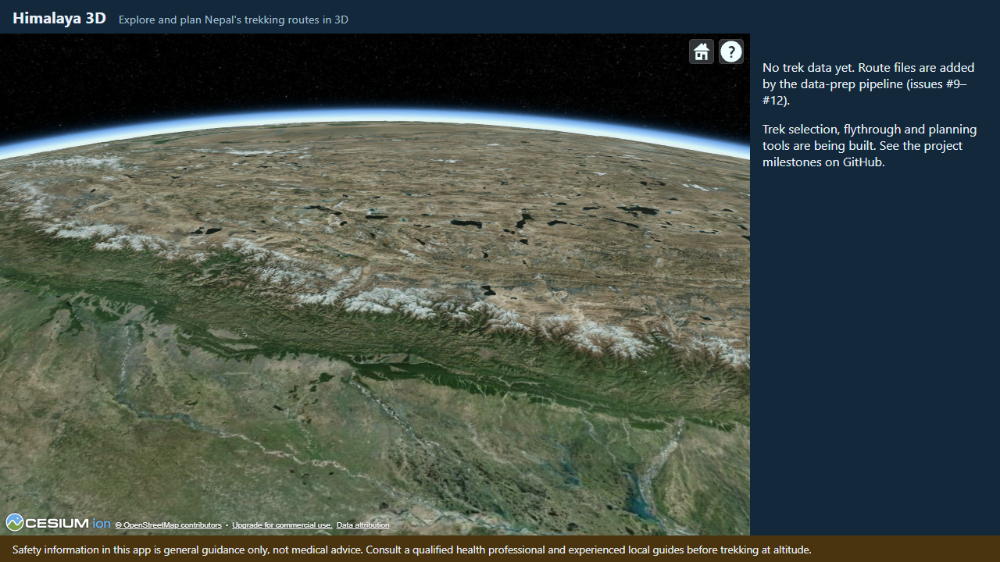

# Himalaya 3D

Interactive 3D visualization and planning platform for Nepal's trekking routes.

KU COMP 206 semester project · Computer Engineering Year II / Semester I · Department of
Computer Science and Engineering, Kathmandu University · Coordinator: Suman Shrestha.

**Live site:** https://dipson6525.github.io/himalaya-3d/ (deployed from `main` by GitHub Actions)



> ⚠️ Safety information in this app is general guidance only, **not medical advice**.

## Features (planned — see milestones)

| | Feature | Status |
| --- | --- | --- |
| FR1 | 3D globe of Nepal with real terrain | Scaffold (M0) → M3 |
| FR2 | Four trekking routes with cited stop altitudes | Drawing works (M3, #15); route data pending (#9–#12) |
| FR3 | Animated flythrough | M4 |
| FR4 | Elevation profile linked to the map | M4 |
| FR5–FR6 | Itinerary planner + acclimatization checker | M5 |
| FR7 | Live earthquakes (USGS) + weather (Open-Meteo) | M6 |
| FR8 | Sun position / time-of-day slider | M6 |
| FR9 | English / Nepali interface | Strings since M0, toggle in M6 |

Details: [`docs/requirements.md`](docs/requirements.md) · Design: [`docs/architecture.md`](docs/architecture.md)

## Setup

Requirements: Git, Node.js 22.17+, 24 or 26+ (an LTS release; CesiumJS and Vitest need this), Python ≥ 3.11.
GDAL is **not** needed.

```bash
git clone https://github.com/dipson6525/himalaya-3d.git
cd himalaya-3d
```

**Cesium token (optional but recommended):** create a free token at https://ion.cesium.com/tokens,
copy `.env.example` to `.env.local` **in the project root**, and paste it there. Never commit it.
Without a token the app still runs with low-resolution offline imagery and no terrain.

### Front end (`app/`)

```bash
cd app
npm ci
npm run dev        # http://localhost:5173
```

| Script | What it does |
| --- | --- |
| `npm run dev` | Dev server with hot reload |
| `npm run build` | Production build into `app/dist/` (base path `/himalaya-3d/`) |
| `npm run preview` | Serve the production build locally |
| `npm run lint` | ESLint + Prettier check |
| `npm run typecheck` | TypeScript strict type check |
| `npm test` | Vitest unit tests |
| `npm run e2e` | Build, then Playwright browser tests (first time: `npx playwright install chromium`). Set `UPDATE_SCREENSHOTS=1` to refresh `docs/screenshots/` |

### Data prep (`data-prep/`)

```bash
cd data-prep
py -3.12 -m venv .venv          # Windows   (macOS/Linux: python3 -m venv .venv)
.venv\Scripts\activate          # Windows   (macOS/Linux: source .venv/bin/activate)
pip install -r requirements.txt
ruff check .
pytest
```

## Project layout

```
app/            React + Vite + TypeScript front end (CesiumJS)
  src/engine/     Cesium viewer, camera, flythrough          (Sparsh)
  src/lib/geo/    haversine, spline, cumulative distance     (Sparsh)
  src/lib/acclim/ acclimatization rules                      (Unique)
  src/features/   routes, itinerary, acclimatization, elevation, layers
  src/ui/         layout, components                         (Dipson)
  src/i18n/       en.json, ne.json                           (Dipson)
  tests/  e2e/    Vitest cross-module tests · Playwright tests
data-prep/      Python pipeline: OSM → cleaned GeoJSON       (Unique)
data/routes/    Route GeoJSON + route-sources.md (citations)
docs/           Requirements, architecture, decisions, viva notes, progress log
```

## Team & roles

| Member | Roll no. | Owns |
| --- | --- | --- |
| Unique Ghimire | 041053-25 | Route data, data-prep, trek content, acclimatization checker |
| Sparsh Gorkhali | 041054-25 | 3D engine, geo maths, flythrough, performance, testing lead |
| Dipson Gurung | 041055-25 | UI, i18n, elevation profile, live layers, documentation |

How we work: one branch + PR per issue (`<member>/<topic>`), Conventional Commits, the owning
student reviews (see ADR-021 for merges while the repo owner is away). See [`CLAUDE.md`](CLAUDE.md) and [`docs/PROGRESS.md`](docs/PROGRESS.md).
AI assistance is disclosed in [`docs/AI_USAGE.md`](docs/AI_USAGE.md).

## Data credits & licences

- **Map data** © [OpenStreetMap contributors](https://www.openstreetmap.org/copyright), ODbL 1.0.
- **3D terrain and imagery**: [Cesium ion](https://cesium.com/) (Cesium World Terrain, ion imagery);
  offline fallback imagery bundled with CesiumJS. Credits are shown on the map.
- **Earthquakes** (M6): U.S. Geological Survey, Earthquake Hazards Program.
- **Weather** (M6): [Weather data by Open-Meteo.com](https://open-meteo.com/), CC BY 4.0.
- **Altitude guidance**: Luks AM et al., *Wilderness Environ Med* 2019;30(4S):S3–S18, and the
  2024 update, *Wilderness Environ Med* 2024;35(1_suppl):2S–19S.
- **Code**: MIT licence (see [`LICENSE`](LICENSE)). Data keeps its own licence.
