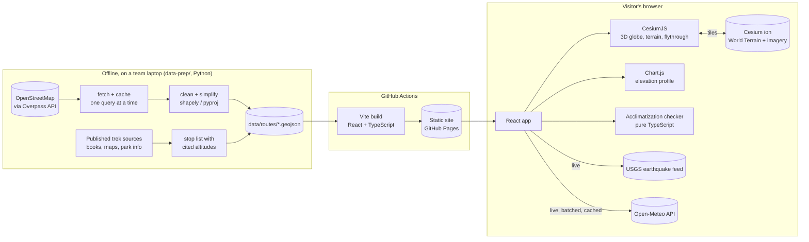
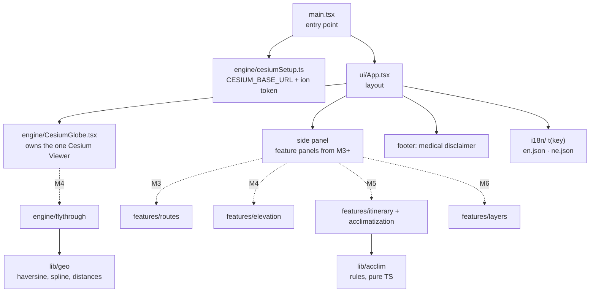
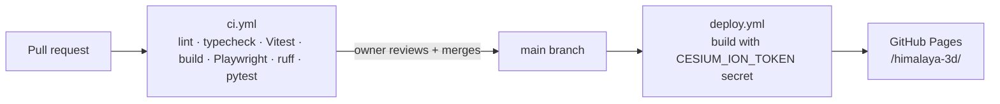

# Architecture — Himalaya 3D

Owner of this document: Dipson Gurung · Issue #4 · Kept current as features land.

## Big picture

Himalaya 3D is a **static website**: HTML, CSS, JavaScript and data files served by GitHub
Pages. There is no server of our own. Heavy work that only needs doing once (downloading and
cleaning trail data) happens **offline** in Python on a team laptop; the results are committed
as GeoJSON. Everything else runs **in the visitor's browser**.

## Why no server?

- **Free and simple to host**: GitHub Pages serves static files for free.
- **Nothing to keep running or secure**: no database, no login, no backend code to patch.
- **The data is small and changes rarely**: a few route files can ship with the site.
- **Downside**: anything secret cannot stay secret. The Cesium ion token is visible in the
  built JavaScript, so we protect it with an *Allowed URLs* restriction on cesium.com instead.
  Live APIs (USGS, Open-Meteo) are free and need no key.

## Front-end structure (`app/`)

Rules that keep this explainable:

- **`lib/` is pure maths** (no React, no Cesium Viewer) → easy to unit-test with Vitest.
- **`engine/` owns Cesium** → one Viewer, created and destroyed in one place.
- **`features/` glue data + UI + engine** for one user-facing feature each.
- **`ui/` is layout and shared components**; **`i18n/` holds every visible string**.

## Folder → owner map

| Folder | Owner | What lives there |
| --- | --- | --- |
| `data-prep/`, `data/routes/` | Unique | Python pipeline, route GeoJSON, source citations |
| `app/src/lib/acclim/`, `app/src/features/acclimatization/` | Unique | Acclimatization rules + itinerary UI |
| `app/src/engine/`, `app/src/lib/geo/` | Sparsh | Cesium viewer, camera, flythrough, geo maths |
| `app/src/ui/`, `app/src/i18n/` | Dipson | Layout, components, translations |
| `app/src/features/elevation/`, `app/src/features/layers/` | Dipson | Elevation profile, live layers |
| `docs/` | Dipson (everyone contributes) | Documentation, viva notes |

## Build & deploy

Key build details (see `app/vite.config.ts`):

- Production `base` is `/himalaya-3d/` because Pages serves the site from that sub-path.
- Cesium's `Workers/`, `Assets/`, `Widgets/`, `ThirdParty/` folders are copied to
  `<base>cesium/`, and `window.CESIUM_BASE_URL` is set to the same path.
- `envDir` is the project root, so the token in `.env.local` is found during local dev/builds.
- Without a token (CI tests, new clones) the globe uses Cesium's bundled offline imagery.

## External services

| Service | Used for | Called from | Limits / etiquette | Credit shown |
| --- | --- | --- | --- | --- |
| Overpass API (OSM) | Trail geometry | data-prep only | One query at a time, cached, never in CI | © OpenStreetMap contributors (ODbL) |
| Cesium ion | World Terrain + imagery | Browser | Token restricted to Pages URL | Cesium credit display |
| USGS Earthquake Hazards Program | Recent earthquakes | Browser (M6) | Public feed | USGS credit on layer |
| Open-Meteo | Weather at stops | Browser (M6) | < 10,000 calls/day, batched + cached | "Weather data by Open-Meteo.com" |
