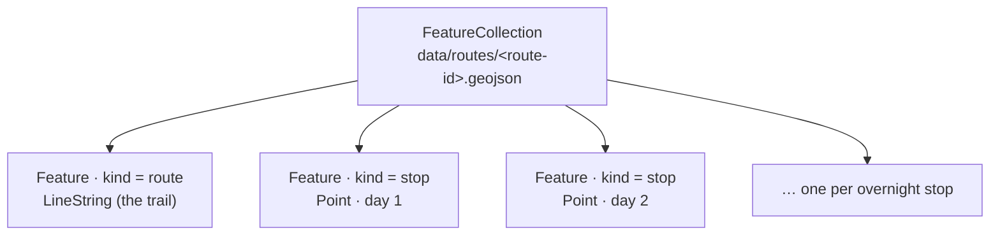

# Route data schema

Owner: Unique Ghimire · Issue #6 · Related FR: FR2 (routes), FR3 (stops)

Every trek is one file in `data/routes/`, named `<route-id>.geojson`, for example
`data/routes/everest-base-camp.geojson`. The web app loads these files as they are, so they must
follow the rules below. `data-prep/prep/schema.py` checks every rule, and CI runs it on every
pull request (`pytest`), so a broken route file can never reach `main`.

## Shape of a file

A route file is a GeoJSON **FeatureCollection** holding:

- exactly **one route feature**: the trail as a `LineString`, plus the trek's names and description;
- **two or more stop features**: one `Point` per overnight stop, in walking order.



Every feature has `properties.kind` set to `"route"` or `"stop"`, so the app can tell them apart.

## Route feature

| Property | Type | Rule |
| --- | --- | --- |
| `kind` | text | Always `"route"` |
| `id` | text | Lowercase words joined by hyphens (`everest-base-camp`); must equal the file name without `.geojson` |
| `name_en` | text | English name of the trek |
| `name_ne` | text | Nepali name, must contain Devanagari script |
| `description_en` | text | One or two sentences in English |
| `description_ne` | text | The same in Nepali, must contain Devanagari script |
| `geometry_source` | text | A Source ID from `data/routes/route-sources.md` (usually `OSM`) |

**Geometry:** a `LineString` with at least 2 positions.

## Stop feature

| Property | Type | Rule |
| --- | --- | --- |
| `kind` | text | Always `"stop"` |
| `id` | text | Lowercase words joined by hyphens (`namche-bazaar`); unique within the file |
| `name_en` | text | English name |
| `name_ne` | text | Nepali name, must contain Devanagari script |
| `day` | whole number | The trek day you **arrive and sleep** here, starting at 1; larger than the previous stop's day |
| `altitude_m` | number | Altitude in metres, between 0 and 8,849 |
| `altitude_source` | text | A Source ID from `data/routes/route-sources.md` |
| `description_en` | text | One or two sentences in English |
| `description_ne` | text | The same in Nepali, must contain Devanagari script |

**Geometry:** a `Point`.

### Where are `lat` and `lon`?

They are the Point's coordinates, not properties. GeoJSON writes every position as
**`[longitude, latitude]`**, which is the opposite of how people usually say it. Keeping the
position only in the geometry means it can never disagree with a second copy stored in
`properties`.

### Rest days and nights per stop

There is no separate "rest day" field. The number of nights spent at a stop is the gap to the
next stop's `day`:

```
nights at a stop = next stop's day − this stop's day
```

Example: if Namche Bazaar has `day: 2` and the next stop has `day: 4`, the trekker sleeps at
Namche on nights 2 and 3, so day 3 is a rest (acclimatization) day. The last stop counts as one night.
The acclimatization checker (M5) builds its list of sleeping altitudes from this.

## Rules for every position

- Exactly two numbers: `[longitude, latitude]` (no third "height" value: altitude lives in
  `altitude_m`, where it must cite a source).
- Inside a loose box around Nepal: latitude 26.0–31.0 °N, longitude 79.5–88.5 °E. The box is
  deliberately larger than the country; its only job is to catch swapped coordinates and typos.
  If a position looks like `[lat, lon]`, the validator says so.

## Rules for every text value

- Must be non-empty.
- Must not contain `TODO`. Unverified values stay in data-prep working files, never in
  `data/routes/`. This enforces the project rule "never invent data".
- Nepali fields (`name_ne`, `description_ne`) must contain at least one Devanagari character,
  which catches English text pasted into the wrong field.

Unknown property names are errors too, so a typo such as `altitude` instead of `altitude_m` is caught.

## Synthetic example (not real data)

This is the test fixture from `data-prep/tests/test_schema.py`. The names, positions and
altitudes are made up for testing and do not describe any real place.

```json
{
  "type": "FeatureCollection",
  "features": [
    {
      "type": "Feature",
      "properties": {
        "kind": "route",
        "id": "test-route",
        "name_en": "Test Route",
        "name_ne": "परीक्षण मार्ग",
        "description_en": "A made-up route used only in tests.",
        "description_ne": "परीक्षणका लागि मात्र बनाइएको मार्ग।",
        "geometry_source": "OSM"
      },
      "geometry": {
        "type": "LineString",
        "coordinates": [[85.0, 28.0], [85.1, 28.05], [85.2, 28.1]]
      }
    },
    {
      "type": "Feature",
      "properties": {
        "kind": "stop",
        "id": "stop-a",
        "name_en": "Stop A",
        "name_ne": "स्टप ए",
        "day": 1,
        "altitude_m": 1000,
        "altitude_source": "TEST",
        "description_en": "First synthetic stop.",
        "description_ne": "पहिलो परीक्षण बिसौनी।"
      },
      "geometry": { "type": "Point", "coordinates": [85.0, 28.0] }
    },
    {
      "type": "Feature",
      "properties": {
        "kind": "stop",
        "id": "stop-b",
        "name_en": "Stop B",
        "name_ne": "स्टप बी",
        "day": 2,
        "altitude_m": 1500,
        "altitude_source": "TEST",
        "description_en": "Second synthetic stop.",
        "description_ne": "दोस्रो परीक्षण बिसौनी।"
      },
      "geometry": { "type": "Point", "coordinates": [85.2, 28.1] }
    }
  ]
}
```

## Checking files

```bash
cd data-prep
.venv\Scripts\activate            # Windows (macOS/Linux: source .venv/bin/activate)
python -m prep.schema             # validates every file in data/routes/, lists any errors
pytest                            # the same checks, plus the validator's own tests
```

## Matching TypeScript types

The front end describes the same shape in `app/src/features/routes/types.ts`. If you change this
schema, change the validator, its tests and those types in the same pull request.

## Design choices

See ADR-017 in `docs/decisions.md`: one file per route, positions only in geometry, nights
derived from `day`, and `TODO` values rejected.
