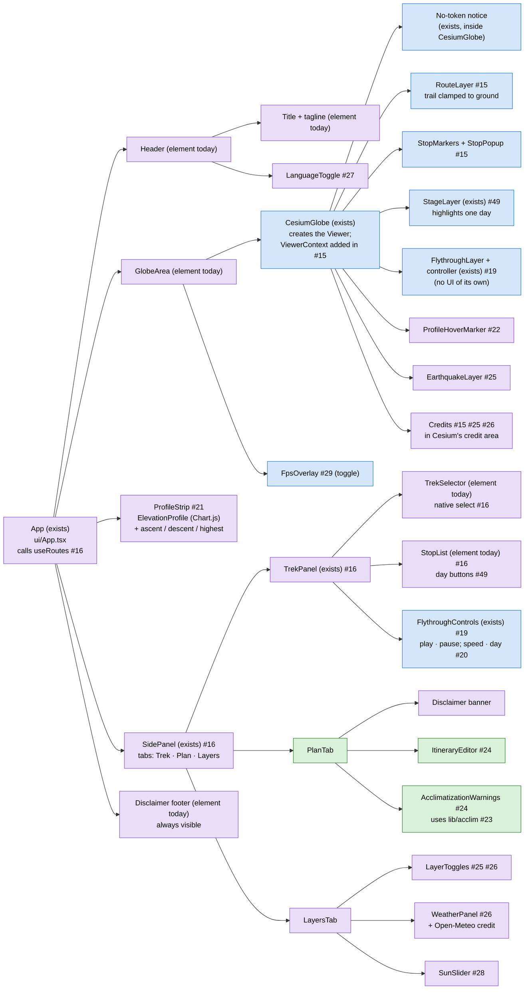
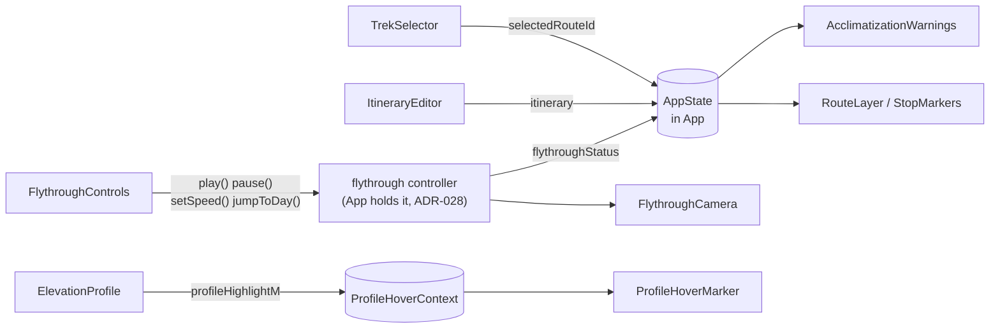

# UI design: component tree, shared state and wireframes

Owner: Dipson Gurung · Issue #7 · Related: all FRs, NFR4 (tablet width), NFR5 (credits), NFR6 (disclaimer)

This is the plan for the screen the team builds in M3–M6. It says **which React components
exist, who owns each one, what data they share, and where everything sits on screen** at desktop
and tablet widths. Wireframes are low-fidelity: boxes and labels only, no real data.

## Layout rules (apply to every screen)

1. **The globe is the main content.** Panels sit beside it (desktop) or below it (tablet); they
   never cover the middle of the globe.
2. **The medical disclaimer is a footer row of the page grid.** It is not inside any scrolling
   area, so no tab, scroll position or window size can hide it (NFR6). The Plan tab repeats it
   at the top, next to the acclimatization warnings, because that is where it matters most.
3. **Data credits stay on the map** (NFR5), in Cesium's own credit area at the bottom-left of
   the globe:
   - Cesium ion logo and "Data attribution" link (Cesium adds these itself);
   - "© OpenStreetMap contributors", always (every trail comes from OSM; added in #14);
   - "Earthquake data: USGS" while the earthquake layer is on;
   - "Weather data by Open-Meteo.com" while weather is shown, and again directly under any
     weather values in the side panel.

   We add each credit as `new Credit(html, true)` with `viewer.creditDisplay.addStaticCredit(...)`.
   The `true` (`showOnScreen`) matters: without it Cesium only lists the credit inside its
   "Data attribution" pop-up, not on the map. Cesium lays the credits out with its own, so they
   never collide with our panels.
4. **Breakpoint at 900 px** (already in `app/src/ui/styles.css`). Wider: globe and a 320 px side
   panel side by side. 900 px or narrower (tablets, including 768 px portrait): everything stacks
   in one column.
5. **Every visible string comes from `t(key, language)`** (`app/src/i18n/`). Nepali text is often
   longer than English, so labels may wrap; no fixed-width buttons. When the language changes,
   `document.documentElement.lang` changes too (`en` or `ne`), so screen readers pronounce the
   text in the right language (#27).
6. **Usable without a mouse.** The side-panel tabs follow the WAI-ARIA "tabs" pattern: the row has
   `role="tablist"`, each tab `role="tab"` with `aria-selected` and `aria-controls`, each panel
   `role="tabpanel"`. Only the selected tab is a Tab-key stop; the arrow keys move between tabs.
   Every other control is reachable with Tab and focus is visible. On touch screens, controls
   are at least 44 × 44 px.
7. **Nepali text needs a Devanagari font.** Most systems ship one (for example Nirmala UI on
   Windows). To look the same on every laptop, #27 can bundle Noto Sans Devanagari (SIL Open Font
   License) instead of relying on what is installed.

## Component tree

Colours show the owner: green = Unique, blue = Sparsh, purple = Dipson. `#n` is the GitHub issue
that builds the component. **(exists)** = already a React component in the code. **(element
today)** = today a plain HTML element inside `App.tsx`; it becomes its own component when it gets
logic of its own. Everything else is still to be built.



| Component | Folder | Owner | FR | Issue |
| --- | --- | --- | --- | --- |
| App, Header, GlobeArea, SidePanel, tabs, DisclaimerFooter | `app/src/ui/` | Dipson | all, NFR6 | #7, #16 |
| LanguageToggle | `app/src/ui/` | Dipson | FR9 | #27 |
| CesiumGlobe (with the no-token notice), ViewerContext | `app/src/engine/` | Sparsh | FR1 | #14, #15 |
| RouteLayer, StopMarkers, StopPopup | `app/src/features/routes/` | Sparsh | FR2 | #15 |
| StageLayer, stage maths (`lib/geo/stages.ts`) | `app/src/features/routes/`, `app/src/lib/geo/` | Sparsh | FR2 | #49 |
| TrekPanel (TrekSelector + StopList) | `app/src/features/routes/` | Dipson | FR2 | #16 |
| FlythroughCamera, FlythroughControls | `app/src/engine/`, `app/src/features/routes/` | Sparsh | FR3 | #19, #20 |
| ElevationProfile, ProfileHoverMarker | `app/src/features/elevation/` | Dipson | FR4 | #21, #22 |
| ItineraryEditor, AcclimatizationWarnings | `app/src/features/acclimatization/`, `features/itinerary/` | Unique | FR5, FR6 | #23, #24 |
| EarthquakeLayer, WeatherPanel, LayerToggles, Credits | `app/src/features/layers/` | Dipson | FR7, NFR5 | #25, #26 |
| SunSlider | `app/src/features/layers/` | Dipson | FR8 | #28 |
| FpsOverlay | `app/src/engine/` | Sparsh | NFR1 | #29 |

## Shared state

Most components only need their own local state (`useState`). A few values are needed by
components in different branches of the tree, for example the selected trek is set in the side
panel but read by the globe, the profile strip and the itinerary. Those values live in **one
place, `App`**, and are handed down through React contexts.

**The rule that shapes everything below:** every component that reads a context re-renders when
that context's value changes. So we put values that change rarely together, and keep values that
change many times a second in a small context of their own (or out of React entirely).

| Shared value | Lives in | Who changes it | Who reads it |
| --- | --- | --- | --- |
| `language` (`'en'` or `'ne'`) | `AppState` | LanguageToggle | every component, through `t()` |
| `selectedRouteId` | `AppState` | TrekSelector | RouteLayer, StopMarkers, StopList, ElevationProfile, ItineraryEditor, WeatherPanel |
| `selectedStopId` | `AppState` | StopMarkers (click), StopList (click) | StopPopup, camera fly-to |
| `flythroughStatus` (playing?, speed) | `AppState` | the flythrough controller (see below) | FlythroughControls (to show the right buttons) |
| `itinerary` (list of days) | `AppState` | ItineraryEditor | AcclimatizationWarnings |
| `layers` (earthquakes on/off, weather on/off) | `AppState` | LayerToggles | EarthquakeLayer, WeatherPanel, Credits |
| `sunTime` (date and time) | `AppState` | SunSlider | CesiumGlobe (scene lighting / clock) |
| `profileHighlightM` (distance along the trail, metres) | `ProfileHoverContext` (its own) | ElevationProfile (hover), RouteLayer (click on trail) | ProfileHoverMarker, ElevationProfile |

`CesiumGlobe` also shares the Cesium Viewer through
`ViewerContext` (added in #15). Neither changes after start-up, so sharing them re-renders nothing.



Four rules keep this simple and fast:

- **Store inputs, compute results.** Acclimatization warnings are not stored. They are
  recalculated from `itinerary` on every render by the pure function in `lib/acclim/`, so they
  can never be out of date.
- **Per-frame values stay out of React.** During a flythrough the camera position changes about
  60 times a second. Putting it in React state would re-render the page every frame. The camera
  position lives inside `FlythroughController`, which runs its own `requestAnimationFrame` loop
  (ADR-028).
- **Fast-changing values get their own small context.** Moving the mouse over the chart changes
  `profileHighlightM` many times a second. In `AppState` it would re-render every component that
  reads `AppState`; in `ProfileHoverContext` it re-renders only the chart and the marker. The
  chart also updates it at most once per animation frame (`requestAnimationFrame`).
- **Commands are method calls, not state.** "Play" or "jump to day 3" is an event, not a value.
  Stored as state, the receiver would have to work out whether it had already handled it (two
  clicks on "jump to day 3" store the same value twice). So FlythroughControls call methods on
  the flythrough controller, which runs each command once and reports `flythroughStatus` back so
  the buttons show the right state.

## Wireframes

Placeholders in `<angle brackets>` stand for real values that come from the route files and live
APIs. No numbers are shown on purpose: wireframes describe layout, not data.

Only plain characters are used inside the boxes so they line up in any font:

| In the wireframe | In the app |
| --- | --- |
| `NE` | the Nepali button, labelled नेपाली |
| `!` | warning icon |
| `o` | stop marker |
| `>` and `\|\|` | play and pause icons |
| `v` | drop-down arrow |
| `[home][?]` | Cesium's home and help buttons |

### Desktop (wider than 900 px, e.g. a 1366 × 768 laptop), Trek tab

```text
┌───────────────────────────────────────────────────────────────────────────────────┐
│ Himalaya 3D   Explore and plan Nepal's trekking routes in 3D   [ EN | NE ]        │ Header
├────────────────────────────────────────────────────────────┬──────────────────────┤
│                                                  [home][?] │ [Trek]  Plan  Layers │
│                                                            │ -------------------- │
│                    3D GLOBE (Cesium)                       │ Trek                 │
│                                                            │ [ <trek name>     v] │
│        ~~~~ trail line clamped to the terrain ~~~~         │ <short description>  │
│      o <stop>          o <stop>          o <stop>          │                      │
│                ┌──────────────────────────┐                │ Stops                │
│                │ <stop name, EN or NE>    │ StopPopup      │  Day <n>  <stop>  >  │
│                │ <altitude> m  (<source>) │                │  Day <n>  <stop>  >  │
│                │ Day <n> . <description>  │                │  ...                 │
│                └──────────────────────────┘                │                      │
│                                                            │ Flythrough           │
│ [FPS <n>] (toggle)                                         │ [> Play] [|| Pause]  │
│ (Cesium ion) Data attribution . (c) OpenStreetMap contrib. │ Speed [ 1x v]        │
├────────────────────────────────────────────────────────────┤ Jump to day [<n> v]  │
│ Elevation profile                              [v Hide]    │                      │
│  m |        /\      /\/\                                   │                      │
│    |   /\/\/  \/\/\/    \__       up:   <total ascent>     │                      │
│    +-------------------------> km  down: <total descent>   │                      │
│    hover here = marker on globe    top:  <highest point>   │                      │
├────────────────────────────────────────────────────────────┴──────────────────────┤
│ ! Safety information in this app is general guidance only, not medical advice.    │ Footer
└───────────────────────────────────────────────────────────────────────────────────┘
```

Why the elevation profile is a strip under the globe and not a side-panel tab: a chart of a
multi-day trek needs width, and putting it directly under the map makes the hover link between
chart and map easy to follow. It can be hidden to give the globe more room.

### Desktop, Plan tab (side panel only; the rest of the screen is unchanged)

```text
┌────────────────────────┐
│ Trek  [Plan]  Layers   │
│ ---------------------- │
│ ! General guidance,    │ <- disclaimer banner, always at the top of this tab
│   not medical advice.  │
│ ---------------------- │
│ Day <n>  <stop>     v  │ <- choose the sleeping stop
│   <altitude> m         │
│ Day <n>  <stop>     v  │
│   ! <reason>           │ <- warning next to the day it applies to
│ Day <n>  <stop>     v  │
│ [+ Add day] [Reset]    │
│ move up/down . remove  │
│ Source: Luks et al.    │ <- guideline citation
└────────────────────────┘
```

### Desktop, Layers tab

```text
┌────────────────────────┐
│ Trek  Plan  [Layers]   │
│ ---------------------- │
│ [x] Earthquakes        │
│     past <period>      │
│ [x] Weather at stops   │
│ ---------------------- │
│ <stop>  <icon> <temp>  │
│ <stop>  <icon> <temp>  │
│ Weather data by        │ <- Open-Meteo credit next to the values
│ Open-Meteo.com         │
│ ---------------------- │
│ Sun position           │
│ <date> [----o-----]    │
│ Sunrise <time>         │
│ Sunset  <time>         │
│ ! <offline message>    │ <- only shown when a live request fails
└────────────────────────┘
```

### Tablet (900 px or narrower, e.g. 768 × 1024 portrait)

```text
┌────────────────────────────────────────────┐
│ Himalaya 3D                 [ EN | NE ]    │ Header (the tagline wraps
│ Explore and plan Nepal's trekking routes   │ onto a second line)
├────────────────────────────────────────────┤
│                                   [home][?]│
│                                            │
│              3D GLOBE (Cesium)             │ about half the screen height
│     ~~~ trail ~~~   o <stop>   o <stop>    │
│                                            │
│ (Cesium ion) . (c) OpenStreetMap contrib.  │
├────────────────────────────────────────────┤
│ Elevation profile               [> Show]   │ collapsed by default
├────────────────────────────────────────────┤
│  [Trek]       Plan        Layers           │ tabs, 44 px tall
│ ------------------------------------------ │
│ Trek [ <trek name>                     v]  │ the panel scrolls inside
│ Stops: Day <n> <stop> > . Day <n> <stop> > │ its own area (at most
│ [> Play] [||]  Speed [1x v]  Day [<n> v]   │ 40% of the screen height)
├────────────────────────────────────────────┤
│ ! Safety information ... not medical advice│ Footer, always visible
└────────────────────────────────────────────┘
```

## Screen states to design for

| State | What the user sees |
| --- | --- |
| No Cesium token | Low-resolution globe, no terrain, the notice at the top-left of the globe (exists) |
| No route files yet | Globe over Nepal; Trek tab shows an empty, disabled selector and "No trek data yet"; profile strip hidden. (When routes exist, the first one is selected at start-up, so there is no "nothing selected" state.) |
| Loading terrain or the profile | A short "Loading…" text in the strip; controls stay usable |
| Live layer fails or the user is offline | The layer turns itself off and shows a one-line message in the Layers tab; the rest of the app keeps working |
| Itinerary with no warnings | A short "No warnings for this plan" line, still under the disclaimer banner |
| WebGL not available | Cesium's own error panel inside the globe area; header, panel and footer still render |

## How this maps to the current code

`app/src/ui/App.tsx` has the header, the globe area, the side panel (`SidePanel.tsx`, with the
Trek, Plan and Layers tabs since #16) and the disclaimer footer, and `styles.css` has the 900 px
breakpoint, the 320 px panel and the 40% height limit for the stacked panel.

**Shared state today (#16).** The first shared value, the selected trek, lives in the `useRoutes`
hook, which `App` calls once and passes down as props: `RouteLayer` gets `routes.current`,
`TrekPanel` gets the whole state (list, `selectedId`, `select`). With one shared value and two
readers, props are simpler to follow than a context, so `AppState` is not built yet. It arrives
when a value is needed deep in several branches (the language, #27, is the likely first).

Still to add:

- the `AppState` context (see above);
- the flythrough's speed and jump-to-day controls (#20). The controller itself exists since #19;
  `FlythroughLayer` hands it to `App` with a callback instead of `ViewerContext` (ADR-028);
- the profile strip row in the grid (#21);
- the USGS and Open-Meteo credits (#25, #26); the OSM credit is on since #14.

### Gaps in the current code this design fixes later

| Gap today | Why it matters | Fix in |
| --- | --- | --- |
| `index.html` always says `lang="en"` | Nepali text would be read with English pronunciation. | #27: set `document.documentElement.lang` with the language toggle |
| `Noto Sans Devanagari` is in the CSS font list but never loaded | It is used only if already installed; otherwise the system's Devanagari font is used. | #27: bundle it, or remove it from the list and rely on system fonts |

Fixed so far: the footer had `role="note"`, which replaced its built-in "contentinfo" landmark
(the one screen-reader users jump to). Since #16 it is a plain `<footer>`, and the e2e tests find
it with `getByRole('contentinfo')`.

## How we will check this design

- **Tablet width (NFR4):** a Playwright test at 768 × 1024 checks that the globe, panel and
  disclaimer are all visible and the panel sits below the globe (#32).
- **Keyboard:** a Playwright test tabs through the header, tabs and panel controls and checks
  that focus reaches each one (#32).
- **Credits and disclaimer (NFR5, NFR6):** the e2e tests check the credit text and the
  disclaimer for each tab (#32).
- **Real users:** the M7 questionnaire (#31) asks whether people could find the trek, plan a
  trip and see the warnings. The team runs it; results are never invented.

Design decisions: see ADR-018 in `docs/decisions.md`.
