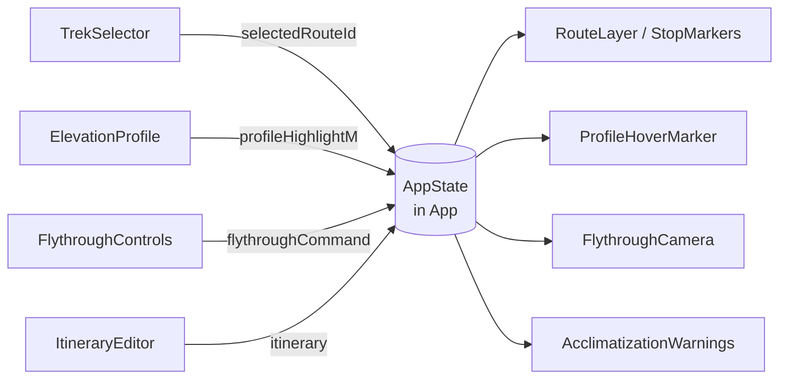

# UI design: component tree, shared state and wireframes

Owner: Dipson Gurung · Issue #7 · Related: all FRs, NFR4 (tablet width), NFR5 (credits), NFR6 (disclaimer)

This is the plan for the screen the team builds in M3–M6. It says **which React components
exist, who owns each one, what data they share, and where everything sits on screen** at desktop
and tablet widths. Wireframes are low-fidelity: boxes and labels only, no real data.

## Layout rules (apply to every screen)

1. **The globe is the main content.** Panels sit beside it (desktop) or below it (tablet); they
   never cover the middle of the globe.
2. **The medical disclaimer is a footer row of the page grid.** It is not inside any scrolling
   area, so no tab, scroll position or window size can hide it (NFR6). The Plan tab repeats it
   at the top, next to the acclimatization warnings, because that is where it matters most.
3. **Data credits stay on the map** (NFR5), in Cesium's own credit area at the bottom-left of
   the globe:
   - Cesium ion logo and "Data attribution" link (Cesium adds these itself);
   - "© OpenStreetMap contributors" whenever a route is shown;
   - "Earthquake data: USGS" while the earthquake layer is on;
   - "Weather data by Open-Meteo.com" while weather is shown, and again directly under any
     weather values in the side panel.

   We add our credits with `viewer.creditDisplay.addStaticCredit(...)`, so Cesium lays them out
   with its own and they never collide with our panels.
4. **Breakpoint at 900 px** (already in `app/src/ui/styles.css`). Wider: globe and a 320 px side
   panel side by side. 900 px or narrower (tablets, including 768 px portrait): everything stacks
   in one column.
5. **Every visible string comes from `t(key, language)`** (`app/src/i18n/`). Nepali text is often
   longer than English, so labels may wrap; no fixed-width buttons.
6. **Usable without a mouse.** Tabs use `role="tablist"`, every control is reachable with Tab, and
   focus is visible. On touch screens, controls are at least 44 × 44 px.

## Component tree

Colours show the owner: green = Unique, blue = Sparsh, purple = Dipson. `#n` is the GitHub issue
that builds the component. Components marked "(exists)" are already in the code.

```mermaid
flowchart TD
  App["App (exists)<br/>ui/App.tsx<br/>holds AppState"]:::dipson

  App --> Header["Header"]:::dipson
  Header --> Title["Title + tagline (exists)"]:::dipson
  Header --> Lang["LanguageToggle #27"]:::dipson

  App --> GlobeArea["GlobeArea"]:::dipson
  GlobeArea --> Globe["CesiumGlobe #14 (exists)<br/>creates the Viewer,<br/>provides ViewerContext"]:::sparsh
  Globe --> RouteLayer["RouteLayer #15<br/>trail clamped to ground"]:::sparsh
  Globe --> Stops["StopMarkers + StopPopup #15"]:::sparsh
  Globe --> Fly["FlythroughCamera #19<br/>(no UI of its own)"]:::sparsh
  Globe --> HoverMarker["ProfileHoverMarker #22"]:::dipson
  Globe --> Quakes["EarthquakeLayer #25"]:::dipson
  Globe --> Credits["Credits<br/>static credits in Cesium's credit area"]:::dipson
  GlobeArea --> Notice["NoTokenNotice (exists)"]:::sparsh
  GlobeArea --> Fps["FpsOverlay #29 (toggle)"]:::sparsh

  App --> Profile["ProfileStrip #21<br/>ElevationProfile (Chart.js)<br/>+ ascent / descent / highest"]:::dipson

  App --> Panel["SidePanel<br/>tabs: Trek · Plan · Layers"]:::dipson
  Panel --> TrekTab["TrekTab"]:::dipson
  TrekTab --> Selector["TrekSelector #16"]:::dipson
  TrekTab --> StopList["StopList #16"]:::dipson
  TrekTab --> FlyControls["FlythroughControls #20<br/>play · pause · speed · day"]:::sparsh
  Panel --> PlanTab["PlanTab"]:::unique
  PlanTab --> PlanNote["Disclaimer banner"]:::dipson
  PlanTab --> Itinerary["ItineraryEditor #24"]:::unique
  PlanTab --> Warnings["AcclimatizationWarnings #24<br/>uses lib/acclim #23"]:::unique
  Panel --> LayersTab["LayersTab"]:::dipson
  LayersTab --> Toggles["LayerToggles #25 #26"]:::dipson
  LayersTab --> Weather["WeatherPanel #26<br/>+ Open-Meteo credit"]:::dipson
  LayersTab --> Sun["SunSlider #28"]:::dipson

  App --> Footer["DisclaimerFooter (exists)<br/>always visible"]:::dipson

  classDef unique fill:#d9f2d9,stroke:#2e7d32,color:#000
  classDef sparsh fill:#d6e6fa,stroke:#1d76db,color:#000
  classDef dipson fill:#e9ddf7,stroke:#8250df,color:#000
```



| Component | Folder | Owner | FR | Issue |
| --- | --- | --- | --- | --- |
| App, Header, GlobeArea, SidePanel, tabs, DisclaimerFooter | `app/src/ui/` | Dipson | all, NFR6 | #7, #16 |
| LanguageToggle | `app/src/ui/` | Dipson | FR9 | #27 |
| CesiumGlobe, NoTokenNotice | `app/src/engine/` | Sparsh | FR1 | #14 |
| RouteLayer, StopMarkers, StopPopup | `app/src/features/routes/` | Sparsh | FR2, FR3 | #15 |
| TrekSelector, StopList | `app/src/features/routes/` | Dipson | FR2 | #16 |
| FlythroughCamera, FlythroughControls | `app/src/engine/`, `app/src/features/routes/` | Sparsh | FR4 | #19, #20 |
| ElevationProfile, ProfileHoverMarker | `app/src/features/elevation/` | Dipson | FR5 | #21, #22 |
| ItineraryEditor, AcclimatizationWarnings | `app/src/features/acclimatization/`, `features/itinerary/` | Unique | FR6 | #23, #24 |
| EarthquakeLayer, WeatherPanel, LayerToggles, Credits | `app/src/features/layers/` | Dipson | FR7, NFR5 | #25, #26 |
| SunSlider | `app/src/features/layers/` | Dipson | FR8 | #28 |
| FpsOverlay | `app/src/engine/` | Sparsh | NFR1 | #29 |

## Shared state

Most components only need their own local state (`useState`). A few values are needed by
components in different branches of the tree, for example the selected trek is set in the side
panel but read by the globe, the profile strip and the itinerary. Those values live in **one
place, `App`**, and are handed down through a React context called `AppState`. Components that
draw on the globe also need the Cesium Viewer, which `CesiumGlobe` provides through a second
context, `ViewerContext`.

| Shared value | Who changes it | Who reads it |
| --- | --- | --- |
| `language` (`'en'` or `'ne'`) | LanguageToggle | every component, through `t()` |
| `selectedRouteId` | TrekSelector | RouteLayer, StopMarkers, StopList, ElevationProfile, ItineraryEditor, WeatherPanel |
| `selectedStopId` | StopMarkers (click), StopList (click) | StopPopup, camera fly-to |
| `profileHighlightM` (distance along the trail, metres) | ElevationProfile (hover), RouteLayer (click on trail) | ProfileHoverMarker, ElevationProfile |
| `flythroughCommand` (play / pause / speed / jump to day) | FlythroughControls | FlythroughCamera |
| `itinerary` (list of days) | ItineraryEditor | AcclimatizationWarnings |
| `layers` (earthquakes on/off, weather on/off) | LayerToggles | EarthquakeLayer, WeatherPanel, Credits |
| `sunTime` (date and time) | SunSlider | CesiumGlobe (scene lighting / clock) |



Two rules keep this simple and fast:

- **Store inputs, compute results.** Acclimatization warnings are not stored. They are
  recalculated from `itinerary` on every render by the pure function in `lib/acclim/`, so they
  can never be out of date.
- **Per-frame values stay out of React.** During a flythrough the camera position changes about
  60 times a second. Putting it in React state would re-render the whole page every frame. The
  camera position lives inside `FlythroughCamera` (Cesium's own render loop); React only sends it
  commands such as play, pause, speed and jump to day N.

## Wireframes

Placeholders in `<angle brackets>` stand for real values that come from the route files and live
APIs. No numbers are shown on purpose: wireframes describe layout, not data.

Only plain characters are used inside the boxes so they line up in any font:

| In the wireframe | In the app |
| --- | --- |
| `NE` | the Nepali button, labelled नेपाली |
| `!` | warning icon |
| `o` | stop marker |
| `>` and `\|\|` | play and pause icons |
| `v` | drop-down arrow |
| `[home][?]` | Cesium's home and help buttons |

### Desktop (wider than 900 px, e.g. a 1366 × 768 laptop), Trek tab

```text
┌───────────────────────────────────────────────────────────────────────────────────┐
│ Himalaya 3D   Explore and plan Nepal's trekking routes in 3D   [ EN | NE ]        │ Header
├────────────────────────────────────────────────────────────┬──────────────────────┤
│                                                  [home][?] │ [Trek]  Plan  Layers │
│                                                            │ -------------------- │
│                    3D GLOBE (Cesium)                       │ Trek                 │
│                                                            │ [ <trek name>     v] │
│        ~~~~ trail line clamped to the terrain ~~~~         │ <short description>  │
│      o <stop>          o <stop>          o <stop>          │                      │
│                ┌──────────────────────────┐                │ Stops                │
│                │ <stop name, EN or NE>    │ StopPopup      │  Day <n>  <stop>  >  │
│                │ <altitude> m  (<source>) │                │  Day <n>  <stop>  >  │
│                │ Day <n> . <description>  │                │  ...                 │
│                └──────────────────────────┘                │                      │
│                                                            │ Flythrough           │
│ [FPS <n>] (toggle)                                         │ [> Play] [|| Pause]  │
│ (Cesium ion) Data attribution . (c) OpenStreetMap contrib. │ Speed [ 1x v]        │
├────────────────────────────────────────────────────────────┤ Jump to day [<n> v]  │
│ Elevation profile                              [v Hide]    │                      │
│  m |        /\      /\/\                                   │                      │
│    |   /\/\/  \/\/\/    \__       up:   <total ascent>     │                      │
│    +-------------------------> km  down: <total descent>   │                      │
│    hover here = marker on globe    top:  <highest point>   │                      │
├────────────────────────────────────────────────────────────┴──────────────────────┤
│ ! Safety information in this app is general guidance only, not medical advice.    │ Footer
└───────────────────────────────────────────────────────────────────────────────────┘
```

Why the elevation profile is a strip under the globe and not a side-panel tab: a chart of a
multi-day trek needs width, and putting it directly under the map makes the hover link between
chart and map easy to follow. It can be hidden to give the globe more room.

### Desktop, Plan tab (side panel only; the rest of the screen is unchanged)

```text
┌────────────────────────┐
│ Trek  [Plan]  Layers   │
│ ---------------------- │
│ ! General guidance,    │ <- disclaimer banner, always at the top of this tab
│   not medical advice.  │
│ ---------------------- │
│ Day <n>  <stop>     v  │ <- choose the sleeping stop
│   <altitude> m         │
│ Day <n>  <stop>     v  │
│   ! <reason>           │ <- warning next to the day it applies to
│ Day <n>  <stop>     v  │
│ [+ Add day] [Reset]    │
│ move up/down . remove  │
│ Source: Luks et al.    │ <- guideline citation
└────────────────────────┘
```

### Desktop, Layers tab

```text
┌────────────────────────┐
│ Trek  Plan  [Layers]   │
│ ---------------------- │
│ [x] Earthquakes        │
│     past <period>      │
│ [x] Weather at stops   │
│ ---------------------- │
│ <stop>  <icon> <temp>  │
│ <stop>  <icon> <temp>  │
│ Weather data by        │ <- Open-Meteo credit next to the values
│ Open-Meteo.com         │
│ ---------------------- │
│ Sun position           │
│ <date> [----o-----]    │
│ Sunrise <time>         │
│ Sunset  <time>         │
│ ! <offline message>    │ <- only shown when a live request fails
└────────────────────────┘
```

### Tablet (900 px or narrower, e.g. 768 × 1024 portrait)

```text
┌────────────────────────────────────────────┐
│ Himalaya 3D                 [ EN | NE ]    │ Header (the tagline wraps
│ Explore and plan Nepal's trekking routes   │ onto a second line)
├────────────────────────────────────────────┤
│                                   [home][?]│
│                                            │
│              3D GLOBE (Cesium)             │ about half the screen height
│     ~~~ trail ~~~   o <stop>   o <stop>    │
│                                            │
│ (Cesium ion) . (c) OpenStreetMap contrib.  │
├────────────────────────────────────────────┤
│ Elevation profile               [> Show]   │ collapsed by default
├────────────────────────────────────────────┤
│  [Trek]       Plan        Layers           │ tabs, 44 px tall
│ ------------------------------------------ │
│ Trek [ <trek name>                     v]  │ the panel scrolls inside
│ Stops: Day <n> <stop> > . Day <n> <stop> > │ its own area (at most
│ [> Play] [||]  Speed [1x v]  Day [<n> v]   │ 40% of the screen height)
├────────────────────────────────────────────┤
│ ! Safety information ... not medical advice│ Footer, always visible
└────────────────────────────────────────────┘
```

## Screen states to design for

| State | What the user sees |
| --- | --- |
| No Cesium token | Low-resolution globe, no terrain, the notice at the top-left of the globe (exists) |
| No trek selected yet | Globe over Nepal; Trek tab shows the selector and a one-line hint; profile strip hidden |
| Loading terrain or the profile | A short "Loading…" text in the strip; controls stay usable |
| Live layer fails or the user is offline | The layer turns itself off and shows a one-line message in the Layers tab; the rest of the app keeps working |
| Itinerary with no warnings | A short "No warnings for this plan" line, still under the disclaimer banner |
| WebGL not available | Cesium's own error panel inside the globe area; header, panel and footer still render |

## How this maps to the current code

`app/src/ui/App.tsx` already has the header, the globe area, a side panel and the disclaimer
footer, and `styles.css` already has the 900 px breakpoint and the 320 px panel. Still to add:
the `AppState` context (when the first shared value arrives in #16), the tabs, the profile strip
row in the grid (#21), and the static credits (#15 adds OSM, #25 and #26 add USGS and Open-Meteo).

Design decisions: see ADR-018 in `docs/decisions.md`.
